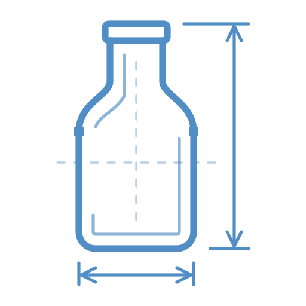

# Schnaps



**A native screen measurement app for macOS.** Find dimensions, measure gaps, and keep the details that make a design work.

[Website](https://getschnaps.com) · [Download for Mac](https://github.com/gabriel/Schnaps/releases/latest/download/Schnaps.dmg) · [Releases](https://github.com/gabriel/Schnaps/releases) · [Documentation](docs/README.md)

## Requirements and installation

macOS 14 or later. The published release is universal: Apple Silicon and Intel.

1. Download and open the DMG.
2. Drag **Schnaps** into **Applications**, then launch it.
3. For edge detection, allow **Screen Recording** in **Schnaps → Settings → Permissions** and enable Schnaps in macOS privacy settings. Relaunch if macOS asks.

Manual area measurement works without Screen Recording permission. The app runs in the menu bar; reopening it shows the native settings window. Enable **Show in Dock** in General settings to also keep it in the Dock. This is off by default and takes effect immediately.

## Tools

**Find Dimensions — ⇧⌘F**

Move the pointer to measure independent horizontal and vertical distances through nearby edges. Click to hold a reading, or drag loosely around an object to snap to its foreground bounds. Press H or V to pin one distance; Space pins both.

**Measure Area — ⇧⌘M**

Drag an exact rectangle. Move it by dragging inside, resize a corner, or use arrow keys to nudge. Shift-drag makes a square. Option-drag or right-drag bypasses object snapping in Find Dimensions.

| Action | Shortcut |
| --- | --- |
| Copy dimensions / CSS | Return / Shift-Return |
| Copy / save screenshot | C / P |
| Toggle screenshot padding | Hold Option with C / P |
| Switch overlay colors | X |
| Pin measurement | Space |
| Pin horizontal / vertical distance | H / V |
| Add horizontal / vertical guide | Shift-H / Shift-V |
| Move / resize selection | Arrows / Option-Arrows |
| Nudge by ten units | Add Shift |
| Switch points / display pixels | U |
| Switch tools | S |
| Change tolerance | T / Shift-T |
| Adjust tolerance in Find Dimensions | Scroll up / down |
| Refresh snapshot | R |
| Clear measurements | Command-K |
| Close overlay | Escape |

Color tolerance has four presets: Zero, Low, Medium, and High. Choose one in the menu bar or Tolerance settings. Scroll during Find Dimensions to move between presets; disable this in Tolerance settings if preferred. Measurements respond immediately, while pins and manually drawn rectangles retain their geometry.

Activation shows only the measurement canvas, without a toolbar, permanent hint banner, or screen dimming. Use keyboard shortcuts to change tools, units, tolerance, and other options.

Global shortcuts can be changed or cleared in **Settings → Shortcuts**, with conflict detection and a restore-defaults button. In-tool keys remain fixed.

Settings include customizable tolerance presets, clipboard formats, Retina scaling, aspect ratios, snapping, live/frozen capture, screenshot export, login items, and appearance. See [measurement preferences](docs/preferences.md) for details. Each display uses its own scale and measurement canvas. Pinned measurements survive toggling the overlay during the current session; they are not saved to disk.

Detection uses color contrast, so solid UI surfaces work best. Gradients, shadows, text, and photos can yield partial or broad measurements. Manual selection is always available. CSS clipboard output uses logical screen coordinates.

## Design tools

Rulers, guides, frames, design grids/mockup overlays, screen templates, Loupe, Crosshair, text inspection, and image/window previews are available from the Design Tools menu and optional native floating Tool Overlay. The overlay is hidden by default; enable it in the menu bar to keep it present across restarts. The compact toolbar has no title bar or window controls. Its inspector button opens tool controls in a popover; Text Inspector and previews use separate windows. Use Control-Command-E to edit markers on screen; Escape dismisses the most recently shown tool; repeat to clear the screen. Turn off Edit on Screen to keep markers visible and click-through. Geometry, colors, and project layouts persist. See the [design tools guide](docs/design-tools.md) for shortcuts, permissions, and integration limits.

## Updates and privacy

**Check for Updates…** is available in **Settings → About Schnaps**, the menu-bar menu, and app menu. About also includes the Stable/Beta channel selector and automatic update check and installation preferences. Sparkle manages update checks and its standard permission flow. Updates and the appcast are signed with Ed25519; published app bundles and DMGs are Developer ID signed and notarized.

Screen images stay in memory on your Mac unless you explicitly copy or save a screenshot. The app has no analytics or accounts. Update checks contact GitHub. The optional responsive preview contacts websites you open. Accessibility is needed only for resizing another app’s attached window; Screen Recording is needed for live pixel/window inspection. Manually placed markers and text tools work without either permission. The website is hosted on Cloudflare and uses cookie-free Cloudflare Web Analytics for visits, page views, and referrers. See [updates and release process](docs/releases.md).

## Build from source

```sh
swift test
swift Scripts/build-app.swift
open build/Schnaps.app
```

Open `Package.swift` in Xcode, or use SwiftPM. The app source is Swift using AppKit, SwiftUI, and ScreenCaptureKit. Sparkle 2 is the update framework; its binary package version and checksum are pinned in `Package.resolved`.

`make beta` builds, signs, notarizes, and publishes the next GitHub prerelease and signed Beta feed; `make plan-beta` previews the version. See [release documentation](docs/releases.md) for signing setup and recovery.

`swift Scripts/build-app.swift --universal` builds both architectures. `--debug` selects debug configuration. For local signing, set `SCHNAPS_SIGN_IDENTITY` to an installed Apple Development identity; otherwise the build is ad-hoc signed. Distribution requires a Developer ID Application identity and notarization credentials.

The app, About, and website use the transparent liquid-glass bottle with external blueprint measurement lines in `Assets/Artwork/Schnaps-Liquid-Glass.png`. Run `swift Scripts/export-icon.swift` to regenerate both ICNS files, PNG previews, and the favicon.

## Project guide

- [Measurement and screenshot preferences](docs/preferences.md)
- [Architecture and measurement behavior](docs/architecture.md)
- [Signed releases, notarization, and Sparkle](docs/releases.md)
- [Build prompts and design iterations](docs/prompts.md)
- [Website source and Cloudflare deployment](website/README.md)
- [Icon artwork and generation prompt](Assets/README.md)

GitHub Actions tests and packages on macOS 15 / Xcode 16.4 and macOS 26 / Xcode 26.3. The app retains its original `com.gabrielhandford.Schnap` bundle identifier to preserve preferences and Screen Recording permission through the Schnaps rename.

Inspired by [xScope](https://xscopeapp.com/), [Vernier](https://usevernier.com/) and the measurement workflow in [PixelSnap](https://pixelsnap.com/). Implemented independently; their application source and artwork are not included. Sparkle's license is bundled with the app in `Contents/Resources/Acknowledgements`.
